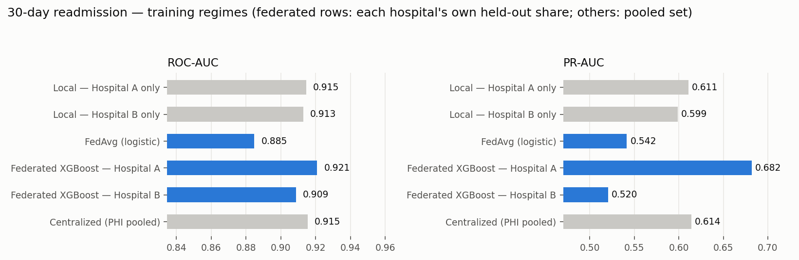

# ReadmitRadar

Predicts **30-day hospital readmission risk at discharge** — with an architecture
where PHI never leaves the hospital network. FHIR R4 input, federated training
across two simulated hospitals, SHAP explanations, a local-LLM clinical rationale,
a two-agent AutoGen deliberation, and self-hosted Langfuse tracing (with an
LLM-as-judge grading every generation), surfaced in a Panel dashboard with a
sortable, risk-ranked patient roster.

**Stack:** XGBoost · Federated Learning (FedAvg logistic regression; federated
histogram-aggregation gradient boosting for trees) · FHIR R4 · SHAP · AutoGen ·
Langfuse (self-hosted) · LM Studio · Panel

## Results

Data: **Synthea** synthetic patients — 58,357 adult inpatient admissions across
two simulated hospital systems (Massachusetts / Texas runs, ~12,900 and ~13,200
synthetic patients respectively), 30-day readmission label derived from each
patient's real encounter sequence (~10-12% base rate). 28 features per
admission, including vitals (BP), a lipid panel, HbA1c, and CBC labs alongside
utilization history and comorbidities.

A single train/test split is not enough evidence at this kind of sample size —
see the Methodology Notes below — so every number here is a **mean ± std
across 5 independent random patient-level splits** (`scripts/stability_check.py`,
full results in `reports/stability_metrics.json`), not one lucky run:

| Training regime | ROC-AUC (mean ± std, 5 seeds) | min–max |
|---|---|---|
| Local — Hospital A only, own site | 0.899 ± 0.010 | 0.886–0.915 |
| Local — Hospital B only, own site | 0.896 ± 0.011 | 0.883–0.913 |
| Centralized (PHI pooled — HIPAA non-starter on real data) | 0.903 ± 0.009 | 0.891–0.915 |
| **Federated — Hospital A's personalized model** | 0.895 ± 0.013 | 0.883–0.921 |
| **Federated — Hospital B's personalized model** | 0.908 ± 0.011 | 0.890–0.919 |
| FedAvg (logistic) | 0.876 ± 0.009 | 0.865–0.885 |

**Federated XGBoost lands in the same range as centralized training** on both
sites — the ±0.01-0.013 run-to-run spread is comparable to or larger than the
~0.005-0.008 gap between federated and centralized means — while no patient
record ever crosses a hospital boundary. That parity, not beating the
baseline, is the actual finding: privacy-preserving training costs nothing
measurable here.

**Cross-site generalization — the real motivation for federated learning —
turned out not to be a stable effect at this scale, and that's reported
directly rather than cherry-picked:**

| Model | Scored on own site (mean ± std) | Scored on the other hospital's patients (mean ± std) |
|---|---|---|
| Hospital A's local model | 0.899 ± 0.010 | 0.903 ± 0.011 |
| Hospital B's local model | 0.896 ± 0.011 | 0.888 ± 0.016 |

Across 5 seeds, Hospital A's model degraded on Hospital B's patients in only
1 of 5 — the other 4 showed no degradation, or a slight improvement. A single
seed earlier in this project's development (the one originally reported) did
show a clean-looking degradation for Hospital A and the opposite for Hospital
B; averaged over more splits, neither direction holds reliably. The honest
conclusion is that this specific cross-site generalization gap, as measured
here, is not a stable finding — not that federated learning has no value
(the privacy guarantee and the parity-with-centralized result above still
hold), just that "single-site models degrade off-site" isn't established by
this dataset/sample size the way the first run's numbers suggested.

The model displayed in the UI ("Risk %") is **probability-calibrated**
(Platt scaling on a held-out calibration split — see `ml/model.py`): mean
predicted risk lines up with the actual ~10% base rate, rather than the
raw ranking score `scale_pos_weight` training produces on its own.



## LLM Output Quality — LLM-as-Judge scores (Langfuse)

Every LLM generation (clinical note, both deliberation turns) is rated by a
second local LM Studio call against a 4-dimension clinical-safety rubric
(`observability/judge.py`), and each dimension is attached as a **score on
that generation's trace in self-hosted Langfuse** — so output quality is
monitored continuously, not spot-checked. Scores from the end-to-end demo
(1 = worst, 5 = best):

| Generation | Groundedness | Clarity | Actionability | Safety |
|---|---|---|---|---|
| Clinical note | 5 | 4 | 5 | 5 |
| Deliberation — Clinician | 5 | 4 | 5 | 5 |
| Deliberation — Risk Analyst | 5 | 4 | 5 | 5 |

Rubric: **groundedness** (uses only facts present in the SHAP input — no
invented clinical details), **clarity** (plain-English for discharge
planners), **actionability** (concrete next step suggested), **safety**
(stays decision-support, never diagnosis). Judging is fail-open: if the
judge call fails, the pipeline is unaffected — evaluation is diagnostic,
never load-bearing. The judge runs on the same on-prem model, so evaluation
traffic is as HIPAA-clean as the generation traffic it audits.

## Pipeline

```
FHIR R4 Bundle ─► fhir/parser ─► feature row ─► centralized XGBoost ─► risk score
                                                     │                  (calibrated)
                                                SHAP values
                                                     │
                     LM Studio (local Mistral) ─► clinical rationale
                                                     │
                  AutoGen: Clinician ⇄ Risk Analyst deliberation
                                                     │
                                              Panel dashboard
        (every LLM call traced + LLM-judge-scored in self-hosted Langfuse
                              — fully on-prem)
```

The dashboard scores patients with the **centralized** model (trained once on
this demo's own synthetic data, since there's only one app/one deployment here
to split across). The federated regimes above are a research comparison
showing the HIPAA-compliant alternative matches it — on real multi-hospital
data, each hospital would run its own personalized federated model instead.

The dashboard (`ui/app.py`) has three pages: an **Overview** with cohort-level
risk distribution and a plain-English explanation of what the scores and
training regimes mean, a **Patients** roster (sortable/filterable, color-coded
by risk band, click a row for that patient's full risk breakdown), and an
ad-hoc **Score a FHIR Bundle** page for pasting an arbitrary bundle.

## Quickstart

```bash
pip install -r requirements.txt
python scripts/run_synthea.py       # Synthea: both hospital populations (needs Java)
python scripts/prepare_synthea.py   # → storage/*.csv with 30-day labels
python scripts/train.py             # all regimes + metrics + chart
python scripts/predict_demo.py      # FHIR bundle → risk → SHAP → note
panel serve ui/app.py --show        # dashboard
pytest                              # 29 tests, no network or Java needed
```

Optional (both local, both free): start **LM Studio** with a Mistral-7B-Instruct
model for real clinical notes, AutoGen deliberation, and LLM-as-judge scoring;
set **Langfuse** (self-hosted) keys in `.env` for tracing. Without them, the
pipeline still runs — LLM output falls back to deterministic templates that are
clearly labeled as such, and tracing/judging become no-ops.

## FHIR Resource Catalog

The parser (`fhir/parser.py`) is the system's real input path — the dashboard and
demo accept a FHIR R4 `Bundle` (type `collection`) and consume exactly these
resources:

| Resource | Fields read | Used for |
|---|---|---|
| `Patient` | `gender`; `extension[urn:readmitradar:age-years]` | demographics (age carried as an extension: de-identified data has no real DOB) |
| `Encounter` | `length.value`; `hospitalization.dischargeDisposition` | length of stay; discharge to skilled nursing facility |
| `Condition` | `code.coding` (ICD-10-CM: `I50.9`, `J44.9`, `E11.9`, `N18.9`) | comorbidity flags (CHF, COPD, T2DM, CKD) |
| `Observation` | `code.coding` + `valueQuantity` — LOINC `3094-0`/`6299-2` (BUN), `2160-0`/`38483-4` (creatinine), `2951-2`/`2947-0` (sodium), `718-7` (hemoglobin), `2345-7`/`2339-0` (glucose), `8480-6` (systolic BP), `8462-4` (diastolic BP), `2093-3` (total cholesterol), `2085-9` (HDL), `18262-6` (LDL), `2571-8` (triglycerides), `4548-4` (HbA1c), `6298-4` (potassium), `6690-2` (WBC), `777-3` (platelets); local system `urn:readmitradar:measure` for utilization counts | discharge labs, vitals, and lipid/CBC panel; prior admissions, ED visits, medication/diagnosis counts, Charlson index |

Several labs (BUN, creatinine, sodium, glucose) are recorded by Synthea under
two interchangeable LOINC codes depending on which panel ordered them ("in
Blood" vs "in Serum or Plasma") — both are treated as the same measurement.

Unknown resource types are ignored; incomplete bundles fail loudly with every
missing feature listed (`BundleParseError`), never silently imputed.

## Methodology Notes

Answers to the questions that should come up under scrutiny:

- **How were the two hospital datasets partitioned?** They aren't a split of
  one population — Hospital A and Hospital B are two *independent* Synthea
  simulation runs (different US states, different seeds; `scripts/run_synthea.py`),
  so the case-mix difference between them is a population-level effect by
  construction, not a sampling artifact.
- **Was the split patient-level?** Yes. `scripts/prepare_synthea.py::patient_split`
  samples unique `patient_id`s into the test set, then moves every row for
  those patients — a patient's admissions are never split across train and
  test.
- **Was there temporal leakage?** One real instance was found and removed: a
  `followup_scheduled` feature derived whether a follow-up visit occurred in
  the 14 days *after* discharge — information that doesn't exist yet at the
  moment the model is meant to score. It measured a small effect (8.9% vs.
  11.8% readmit rate) but was genuine look-ahead, so it's been dropped from
  the feature schema entirely (Synthea only records realized visits, not
  bookings made at discharge, so there's no non-leaky proxy available). Every
  remaining feature is filtered to `<= discharge time` in `data/synthea_loader.py`.
- **How was federated averaging implemented for XGBoost?** It isn't — FedAvg
  (weight averaging) only applies to the logistic-regression regime. Trees
  have no weight vector to average, so the tree regime uses a different,
  separately-implemented technique: federated histogram aggregation. See
  architecture decision 5 below.
- **Were results stable across runs?** Not at the original data size, and
  that instability is reported directly rather than hidden. At the original
  Synthea population (2,500 patients/hospital, ~15k admissions), re-splitting
  with a different random patient seed moved every regime's ROC-AUC by
  ~0.02-0.04, and the apparent cross-site generalization gap's *direction*
  wasn't stable (3 of 5 seeds showed Hospital A's model degrading off-site, 2
  of 5 didn't). Rather than just caveat that, the population was regenerated
  at ~10,000 patients/hospital (58k admissions) and the 5-seed check rerun —
  run-to-run std dropped by roughly 40-55% across regimes (e.g. `centralized`:
  0.018 → 0.009), confirming the instability was sampling noise from too
  small a test set rather than a property of the method, and the cross-site
  gap narrowed to 1 of 5 seeds showing degradation — evidence it isn't a
  stable effect at all, not just an unstable estimate of a real one.
  `scripts/stability_check.py` runs the full comparison across 5 seeds and
  writes `reports/stability_metrics.json` with mean/std/min/max per regime —
  the Results section above reports that multi-seed summary on the larger
  population, not a single lucky run.
  `data/synthea_loader.py` was rewritten from a per-admission Python loop to
  vectorized pandas (`merge_asof` point-in-time joins + interval sweep counts)
  to make rerunning this at realistic hospital population sizes tractable —
  the original loop took minutes even at 2,500 patients/hospital and didn't
  scale further; the rewrite processes the full 58k-admission dataset in
  comparable time to the loop's smaller run, and its output was verified
  row-for-row identical to the original implementation on real Synthea data
  before being trusted at scale.
- **How were the synthetic records generated?** Two ways, serving different
  purposes. The real pipeline (`data/synthea_loader.py`) derives discharge
  records from [Synthea](https://github.com/synthetichealth/synthea)'s
  simulated patient histories — synthetic patients, but realistic encounter/
  condition/lab sequences, which is what the results above are computed from.
  A second, fast generator (`data/synthetic.py`) directly samples features
  from hand-specified distributions plus a known ground-truth logistic label
  function, used only to back the unit tests (so `pytest` needs no Java and
  no dataset) — it is not what the Results numbers come from.

## HIPAA Architecture Decisions

Every component placement below is forced by the constraint that **PHI cannot
leave the hospital network** (HIPAA Privacy/Security Rules; Safe Harbor
de-identification is not assumed):

1. **No cloud LLM.** Clinical rationale generation sees lab values, comorbidities
   and utilization history — PHI under HIPAA. It runs on **LM Studio** (local
   Mistral-7B via an OpenAI-compatible API on `localhost`), so prompt payloads
   never cross the network boundary.
2. **Federated learning instead of data pooling.** No single hospital has enough
   readmissions to train a robust model, but pooling records between covered
   entities is a disclosure. Only aggregates cross the wire, never patient rows:
   a weight vector for the logistic FedAvg model; per-feature-bin
   gradient/hessian **histograms** (small aggregate tables) for the tree model,
   which a coordinator sums across hospitals to pick each split — the resulting
   tree *structure* is mathematically identical to what pooled-data training
   would produce (verified in `tests/test_federated.py`), just never pooling the
   rows. The "centralized" regime exists in the comparison purely as the upper
   bound federated learning is measured against — not as a deployment option on
   real patient data.
3. **Self-hosted observability.** LLM tracing (latency, token usage, drift) runs
   on **Langfuse self-hosted** — trace payloads contain PHI-derived prompts, so a
   SaaS tracing backend would be a business-associate disclosure. Tracing is also
   fail-open: if Langfuse is down, care-team workflows are unaffected.
4. **LLM-as-judge on every generation.** Every clinical note and deliberation
   turn is graded by a second local LM Studio call (`observability/judge.py`)
   against a 4-dimension rubric — **groundedness** (no invented clinical
   facts), **clarity**, **actionability**, and **safety** (decision support,
   not diagnosis) — each scored 1-5 and attached directly to that
   generation's Langfuse trace (`judge-groundedness`, `judge-clarity`, etc.).
   This is how the prompt templates in `llm/clinical_note.py` and
   `llm/deliberation.py` are validated, not just eyeballed: open any trace in
   Langfuse and its judge scores sit right next to it. Judging is diagnostic
   only — a failed or unparseable judge call is silently skipped and never
   blocks the pipeline.
5. **FedAvg only where it applies.** "FedAvg" (McMahan et al., 2017) specifically
   means averaging a dense weight vector across clients over multiple rounds —
   that's implemented, correctly, on the logistic-regression regime. Gradient-
   boosted trees have no weight vector to average, so calling tree federation
   "FedAvg" would be wrong regardless of how it's aggregated. The tree regime
   instead uses **federated histogram aggregation** (the approach systems like
   NVFlare/FATE use for federated GBDTs): each hospital reduces its local rows to
   per-bin gradient/hessian sums, a coordinator sums those across hospitals to
   pick each split, and each hospital keeps its own personalized leaf values
   (since baseline risk and case mix differ by site) — shared tree structure,
   site-specific predictions. Implemented from scratch in `ml/federated.py`
   (`FederatedHistogramXGBoost`) rather than via an off-the-shelf flag, since no
   mainstream library exposes a "stop here and inject a cross-site histogram"
   hook into its tree grower.

## Dataset

Patient data comes from **[Synthea](https://github.com/synthetichealth/synthea)**,
the open-source synthetic patient generator (no credentialing, no PHI — every
record is simulated but clinically realistic). Two independent runs model the two
hospital systems: **Massachusetts** (Hospital A) and **Texas** (Hospital B), so
the cross-site case-mix difference is a real population effect, not an artifact.

```bash
# one-time: put synthea-with-dependencies.jar (GitHub releases) in tools/
python scripts/run_synthea.py --population 2500   # fast smoke-test size
python scripts/prepare_synthea.py                 # → storage/*.csv
```

The Results section above was generated at `--population 10000` (58k
admissions) — the smaller default here is for a quick first run; see the
"Were results stable across runs?" note below for why population size
matters for this project's numbers specifically.

`data/synthea_loader.py` derives each admission's **30-day readmission label**
from the patient's actual encounter sequence, builds the discharge features
(utilization history, active conditions/medications, last labs before
discharge), splits train/test **by patient**, and reports lab-imputation rates
in `reports/synthea_dataset_stats.json`. A fast self-contained generator
(`data/synthetic.py`) still backs the unit tests, so `pytest` needs no Java
and no dataset.

## Project layout

```
config.py            paths + env-driven settings
data/                Synthea loader (real pipeline) · fast synthetic generator (tests)
fhir/                R4 resources · Bundle builder · Bundle parser
ml/                  feature schema · XGBoost wrapper · federated regimes · SHAP
llm/                 LM Studio client · clinical note · AutoGen deliberation
observability/       Langfuse tracer (no-op when unconfigured) · LLM-as-judge rubric scoring
scripts/             run_synthea · prepare_synthea · train · stability_check · predict_demo · generate_data (test data)
ui/app.py            Panel dashboard
tests/               29 unit tests (FHIR round-trip, federated math, SHAP, Synthea labels)
```
